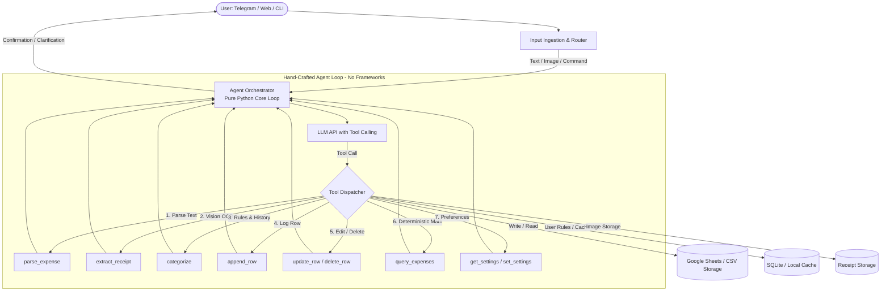

# Expense Tracker Agent: Step-by-Step Execution Plan (`task.md`)

This document outlines the end-to-end, phased implementation and execution roadmap for the **Expense Tracker Agent**, based directly on the specifications defined in [PRD.md](file:///c:/Users/anfas/Desktop/expense%20agent%20tracker/PRD.md).

---

## Architecture Overview



---

## Directory Structure Plan

```text
expense-agent-tracker/
├── PRD.md                          # Product Requirements Document
├── task.md                         # Step-by-step execution plan (this file)
├── .env.example                    # Environment variable template
├── requirements.txt                # Python dependencies
├── config/
│   ├── __init__.py
│   ├── settings.py                 # Pydantic configuration & env vars
│   └── categories.json             # Default category taxonomy & rules
├── src/
│   ├── __init__.py
│   ├── agent/
│   │   ├── __init__.py
│   │   ├── core.py                 # Hand-crafted agent loop (pure Python)
│   │   ├── prompts.py              # System prompts & few-shot examples
│   │   ├── state.py                # Session & conversation memory
│   │   └── guardrails.py           # Safety limits, confirmation checks
│   ├── tools/
│   │   ├── __init__.py
│   │   ├── registry.py             # Tool registration & schema definitions
│   │   ├── parser.py               # parse_expense implementation
│   │   ├── receipt_scanner.py      # extract_receipt multimodal vision tool
│   │   ├── categorizer.py          # Rule-based + history + LLM categorizer
│   │   ├── spreadsheet.py          # Google Sheets / CSV append_row, update_row
│   │   └── query_engine.py         # Deterministic query_expenses & aggregation
│   ├── storage/
│   │   ├── __init__.py
│   │   ├── sheets_client.py        # Google Sheets API client (gspread/oauth)
│   │   ├── local_db.py             # SQLite for merchant history & settings
│   │   └── receipt_store.py        # Local/Cloud receipt image handler
│   ├── interfaces/
│   │   ├── __init__.py
│   │   ├── cli.py                  # Developer interactive CLI
│   │   ├── telegram_bot.py         # Telegram bot interface
│   │   └── api.py                  # Optional FastAPI webhooks/endpoints
│   └── models/
│       ├── __init__.py
│       └── schemas.py              # Pydantic models (Expense, Receipt, etc.)
├── tests/
│   ├── __init__.py
│   ├── test_parser.py              # Unit tests for text parsing
│   ├── test_categorizer.py         # Unit tests for category hierarchy
│   ├── test_query_engine.py        # Unit tests for deterministic math
│   ├── test_agent_loop.py          # End-to-end loop tests with mock LLM
│   └── evaluation/
│       ├── dataset_text_100.json   # 100 benchmark text inputs
│       ├── dataset_receipts/       # Benchmark receipt images
│       └── run_eval.py             # Benchmark runner & accuracy reporter
└── data/                           # Local runtime artifacts (gitignored)
    ├── receipts/
    ├── app.db
    └── local_backup.csv
```

---

## Step-by-Step Execution Roadmap

### Phase 0: Project Setup & Environment Configuration

- [x] **Task 0.1: Initialize Project Scaffolding & Virtual Environment**
  - Create directory layout (`config/`, `src/`, `tests/`, `data/`).
  - Initialize Python virtual environment (`python -m venv .venv`).
  - Configure `.gitignore` (ignore `.env`, `.venv`, `data/`, Google service account secrets, and `__pycache__`).

- [x] **Task 0.2: Define Dependencies & Requirements**
  - Create `requirements.txt` with core libraries (avoiding heavyweight agent frameworks):
    - LLM Provider SDK (e.g. `anthropic` or `google-genai` / `google-generativeai`)
    - `pydantic` & `pydantic-settings` (data validation)
    - `gspread` & `google-auth` (Google Sheets integration)
    - `pandas` / `sqlite3` (deterministic calculations & local caching)
    - `python-dateutil` & `pytz` (relative dates & timezone handling)
    - `python-telegram-bot` (Telegram bot interface)
    - `pillow` (image preprocessing & compression)
    - `pytest` & `pytest-asyncio` (testing suite)

- [x] **Task 0.3: Configuration & Environment Management**
  - Create [config/settings.py](file:///c:/Users/anfas/Desktop/expense%20agent%20tracker/config/settings.py) and `.env.example`.
  - Support configuration keys: `LLM_API_KEY`, `LLM_MODEL`, `TELEGRAM_BOT_TOKEN`, `GOOGLE_SHEET_ID`, `GOOGLE_CREDENTIALS_PATH`, `DEFAULT_CURRENCY` (default: `INR`), `DEFAULT_TIMEZONE` (default: `Asia/Kolkata`).
  - Create [config/categories.json](file:///c:/Users/anfas/Desktop/expense%20agent%20tracker/config/categories.json) defining default categories: `Groceries`, `Dining`, `Transport`, `Fuel`, `Utilities`, `Rent`, `Shopping`, `Health`, `Entertainment`, `Education`, `Travel`, `Subscriptions`, `Other`.

- [x] **Task 0.4: Define Data Models & Pydantic Schemas**
  - Create [src/models/schemas.py](file:///c:/Users/anfas/Desktop/expense%20agent%20tracker/src/models/schemas.py) matching PRD Section 6:
    - `ExpenseEntry`: `id`, `date`, `amount`, `currency`, `merchant`, `category`, `payment_method`, `notes`, `source`, `receipt_url`, `confidence`, `created_at`.
    - `ReceiptExtractedData`: `merchant`, `date`, `total_amount`, `currency`, `line_items`, `confidence`.
    - `UserPreferences`: `currency`, `timezone`, `category_rules`, `monthly_budgets`.
    - `QueryFilter`: `start_date`, `end_date`, `category`, `merchant`, `aggregate_by`.

---

### Phase 1: Core Agent Engine & Tool Loop (Pure Python)

*Constraint (PRD 7.1): Hand-written loop in plain Python without LangChain, LlamaIndex, or CrewAI.*

- [x] **Task 1.1: Build Generic LLM Client & Tool Registry**
  - Implement [src/tools/registry.py](file:///c:/Users/anfas/Desktop/expense%20agent%20tracker/src/tools/registry.py) with decorator `@register_tool` producing valid tool/function JSON schemas.
  - Implement [src/agent/core.py](file:///c:/Users/anfas/Desktop/expense%20agent%20tracker/src/agent/core.py) LLM client adapter supporting tool calling, multi-turn message history, and structured response parsing.

- [x] **Task 1.2: Implement Tool 1 – `parse_expense` (NLP Extraction)**
  - Implement [src/tools/parser.py](file:///c:/Users/anfas/Desktop/expense%20agent%20tracker/src/tools/parser.py).
  - Extract structured fields from raw text: amount, currency (INR default, Rs/rupees/₹), merchant, date (resolve relative dates like "yesterday", "last Friday" using `Asia/Kolkata`), payment method.
  - Support multiple items in a single message (e.g. "auto 80, coffee 120 and lunch 250").
  - Assign extraction confidence score (0.0 to 1.0).

- [x] **Task 1.3: Implement Tool 2 – `categorize` (Tri-Level Hierarchy)**
  - Implement [src/tools/categorizer.py](file:///c:/Users/anfas/Desktop/expense%20agent%20tracker/src/tools/categorizer.py) executing in order:
    1. **User Exact Rules** (e.g., "Swiggy is always Dining").
    2. **Learned Historical Mapping** (cached merchant-to-category associations from user's past entries).
    3. **LLM Zero-Shot Categorization** with prompt restricted to allowed categories.
  - Fallback to `Other` or trigger clarification if confidence < 0.6.

- [x] **Task 1.4: Implement Hand-Written ReAct Loop & Intent Router**
  - Implement step-by-step orchestrator loop in [src/agent/core.py](file:///c:/Users/anfas/Desktop/expense%20agent%20tracker/src/agent/core.py):
    1. Receive input (text/image/context).
    2. Dispatch to LLM with active tools.
    3. Intercept tool call, validate arguments via Pydantic schemas.
    4. Execute tool function locally and feed `tool_result` back to LLM.
    5. Terminate when final user-facing text is produced or user feedback is requested.
  - Apply safety limits: max iterations per turn (e.g. 5) to prevent runaways.

- [x] **Task 1.5: Unit Test Agent Core Loop with Mock Tools**
  - Write [tests/test_agent_loop.py](file:///c:/Users/anfas/Desktop/expense%20agent%20tracker/tests/test_agent_loop.py) testing conversational text parsing without network calls.

---

### Phase 2: Storage Layer & Spreadsheet Integration

- [x] **Task 2.1: Local Database & Persistence Layer**
  - Implement [src/storage/local_db.py](file:///c:/Users/anfas/Desktop/expense%20agent%20tracker/src/storage/local_db.py) (SQLite) to store:
    - User settings (budgets, preferences, rules).
    - Merchant-to-category correction cache.
    - Active session state & recent expense IDs (for fast "change that" context).
    - Local fallback transaction log for offline/resilient sync.

- [x] **Task 2.2: Google Sheets API Client & Sheet Initializer**
  - Implement [src/storage/sheets_client.py](file:///c:/Users/anfas/Desktop/expense%20agent%20tracker/src/storage/sheets_client.py) using service account or user OAuth.
  - Auto-create sheet structure if not present:
    - **Expenses Sheet**: columns `[id, date, amount, currency, merchant, category, payment_method, notes, source, receipt_url, confidence, created_at]`.
    - **Summary Sheet**: dynamic formula-driven table (Monthly totals by Category, Budget, Remaining, % Used).
  - Format headers, date formatting, and frozen top row.

- [x] **Task 2.3: Implement Tool 3 & 4 – `append_row` and Sheet Writers**
  - Implement [src/tools/spreadsheet.py](file:///c:/Users/anfas/Desktop/expense%20agent%20tracker/src/tools/spreadsheet.py).
  - Generate deterministic unique UUIDs (`exp_xxxxxx`).
  - Batch append rows when multiple expenses are provided in one turn.
  - Guarantee user manual edits on existing rows are never overwritten (PRD FR-17).

---

### Phase 3: Multimodal Vision & Receipt Extraction

- [x] **Task 3.1: Receipt Ingestion & Preprocessing**
  - Implement [src/storage/receipt_store.py](file:///c:/Users/anfas/Desktop/expense%20agent%20tracker/src/storage/receipt_store.py) to save images locally / cloud.
  - Image optimization: auto-orient, compress large images (>2MB) to reduce latency and API cost (PRD Section 12).

- [x] **Task 3.2: Implement Tool – `extract_receipt` with Multimodal Vision**
  - Implement [src/tools/receipt_scanner.py](file:///c:/Users/anfas/Desktop/expense%20agent%20tracker/src/tools/receipt_scanner.py).
  - Craft specialized vision prompt returning:
    - Merchant name
    - Date of transaction
    - Subtotal, taxes, and Total Amount
    - Line item list (if legible)
    - Confidence score
  - Support printed paper receipts, handwritten bills, and digital UPI payment screenshots.

- [x] **Task 3.3: Interactive Receipt Confirmation Flow**
  - Implement the two-step verification flow:
    - When receipt is processed, present summary to user: *"Found: Big Bazaar, ₹1,284, 10 Nov. Category: Groceries. Save it?"*
    - Hold entry in transient state until confirmed or edited by user.

---

### Phase 4: State Management, Corrections & Duplicate Detection

- [x] **Task 4.1: Contextual State & Recent Operations Memory**
  - Implement [src/agent/state.py](file:///c:/Users/anfas/Desktop/expense%20agent%20tracker/src/agent/state.py) to keep track of the last $N$ actions (last created entry ID, last query result).
  - Support relative conversational updates (e.g. *"change that to 540"*, *"mark it as dining"*).

- [x] **Task 4.2: Implement Tools – `update_row` and `delete_row`**
  - Implement safe update and deletion operations in [src/tools/spreadsheet.py](file:///c:/Users/anfas/Desktop/expense%20agent%20tracker/src/tools/spreadsheet.py).
  - Integrate Guardrails:
    - Single entry edit/delete executes directly with confirmation.
    - Bulk delete or wipe requires explicit confirmation token.

- [x] **Task 4.3: Learning from Corrections**
  - When user changes a category (e.g. user updates *"Uber"* from *Other* to *Transport*):
    - Update the local rule store in `local_db.py`.
    - Automatically classify future transactions from this merchant accordingly (PRD FR-9).

- [x] **Task 4.4: Duplicate Detection Engine**
  - Implement duplicate check before `append_row`:
    - Check if an entry with identical `amount`, `merchant`, and `date` exists within the last 48 hours.
    - If found, prompt user: *"Possible duplicate found: ₹450 at Groceries on 11 Nov already logged. Do you still want to save it?"*

---

### Phase 5: Deterministic Query & Financial Insights Engine

*Constraint (PRD FR-20, 7.3): Compute all financial answers using code/math, never LLM calculation hallucinations.*

- [x] **Task 5.1: Implement Tool – `query_expenses`**
  - Implement [src/tools/query_engine.py](file:///c:/Users/anfas/Desktop/expense%20agent%20tracker/src/tools/query_engine.py).
  - LLM extracts parameters into `QueryFilter` (e.g. `{category: 'Dining', start_date: '2026-10-01', end_date: '2026-10-31'}`).
  - Query engine executes deterministic filtering & aggregation via Pandas/SQLite.
  - Return structured metrics: total spent, transaction count, average per transaction, comparison to previous period.
  - LLM receives exact computed numbers to generate conversational response (e.g. *"₹6,420 across Groceries (₹3,900) and Dining (₹2,520), up 8% from last month."*).

- [x] **Task 5.2: Budget Threshold Tracking & Alerts**
  - Implement category budget monitoring against monthly spending.
  - Return alert notices when spending reaches 80% and 100% of defined budget thresholds.

- [x] **Task 5.3: Periodic Summaries (Weekly / Monthly)**
  - Implement aggregation script generating clean markdown breakdown of top spending categories, total expenditure, and budget status.

---

### Phase 6: User Interfaces & Deployment Channels

- [x] **Task 6.1: Interactive Developer CLI Harness**
  - Implement [src/interfaces/cli.py](file:///c:/Users/anfas/Desktop/expense%20agent%20tracker/src/interfaces/cli.py).
  - Provide an interactive REPL for rapid testing:
    - Text commands (`spent 250 on lunch`)
    - Image testing (`/receipt path/to/receipt.jpg`)
    - Querying (`how much on food this month?`)

- [x] **Task 6.2: Telegram Bot Integration**
  - Implement [src/interfaces/telegram_bot.py](file:///c:/Users/anfas/Desktop/expense%20agent%20tracker/src/interfaces/telegram_bot.py).
  - Handle `MessageHandler(filters.TEXT)`: route text messages to agent loop.
  - Handle `MessageHandler(filters.PHOTO)`: download photo, route to multimodal receipt pipeline.
  - Handle `/start`, `/help`, `/summary`, `/settings` commands.
  - Fast feedback: show "typing..." or "processing receipt..." action indicators.

- [x] **Task 6.3: Webhook / Service Runner**
  - Implement entry point `main.py` allowing running in either CLI mode or Telegram Polling/Webhook daemon mode.
  - Implement graceful shutdown, retry logic, and error alerting.

---

### Phase 7: Evaluation, Quality Assurance & Hardening

- [x] **Task 7.1: Build Golden Test Datasets (PRD Section 10)**
  - Build `tests/evaluation/dataset_text_100.json` with 100 text phrases:
    - Standard entries ("spent 450 on groceries")
    - Slang and abbreviations ("chai 20", "swiggy 340", "petrol 500")
    - Relative dates ("yesterday", "last Sunday", "2 days ago")
    - Multiple entries in one line ("auto 80, coffee 120 and lunch 250")
  - Collect `tests/evaluation/dataset_receipts/` with 50 diverse receipt images:
    - Clear printed receipts, crumpled bills, thermal paper receipts, UPI payment screenshots.
  - Build 30 test query questions with verified ground-truth math.

- [x] **Task 7.2: Build Automated Evaluation Suite (`run_eval.py`)**
  - Implement automated runner comparing model extractions with ground-truth values.
  - Measure accuracy metrics against PRD targets:
    - Amount extraction accuracy $\ge 98\%$
    - Receipt amount accuracy $\ge 92\%$
    - Categorization accuracy $\ge 90\%$
    - Query calculation accuracy $\ge 95\%$

- [x] **Task 7.3: Performance & Latency Optimization**
  - Benchmark text logging latency (target: p95 < 5s).
  - Benchmark receipt scanning latency (target: p95 < 15s).
  - Add request retry mechanisms with exponential backoff for Google Sheets and LLM APIs.

---

### Phase 8: Expansion Features (PRD Section 11)

- [x] **Task 8.1: UPI Screenshot Parser Engine**
  - Implement specialized extraction for Google Pay, PhonePe, and Paytm receipts.
  - Detect UPI IDs, transaction reference numbers, and auto-set `payment_method="UPI"`.

- [x] **Task 8.2: Voice Note Audio Transcription Pipeline**
  - Implement audio receiver in Telegram bot (`filters.VOICE`) and local audio handler.
  - Transcribe spoken speech to text and route into the agent loop.

- [x] **Task 8.3: Multi-Currency Converter & Normalizer**
  - Detect foreign currencies ($ / USD, € / EUR, £ / GBP, AED) in messages.
  - Convert to base currency (INR) and log original currency in `notes`.

---

## Execution Order & Dependency Matrix

| Step | Action | Prerequisite | Deliverable |
|:---:|---|---|---|
| **1** | Project Setup & Schemas | None | `requirements.txt`, `config/`, `src/models/schemas.py` |
| **2** | Pure Python Agent Loop & LLM Client | Step 1 | `src/agent/core.py`, `src/tools/registry.py` |
| **3** | Parser & Categorizer Tools | Step 2 | `src/tools/parser.py`, `src/tools/categorizer.py` |
| **4** | Local DB & Google Sheets Storage | Step 1 | `src/storage/`, `src/tools/spreadsheet.py` |
| **5** | Interactive CLI Prototype (Phase 0 Complete) | Steps 2-4 | Working CLI logging text to Sheet |
| **6** | Receipt Vision Extraction (Phase 1) | Steps 3-5 | `src/tools/receipt_scanner.py`, image pipeline |
| **7** | Conversational State, Edit/Delete & Duplicates | Step 5 | `src/agent/state.py`, update/delete tools |
| **8** | Deterministic Query Engine (Phase 2) | Step 4 | `src/tools/query_engine.py` |
| **9** | Telegram Bot Interface | Steps 5-8 | `src/interfaces/telegram_bot.py` |
| **10** | Benchmark Evaluation & Quality Assurance | Steps 6-9 | `tests/evaluation/run_eval.py`, accuracy reports |

---

## Verification & Acceptance Checklist

- [x] Text entry logs to Google Sheets with correct amount, merchant, category, and date.
- [x] Relative dates ("yesterday", "last Friday") compute correctly according to `Asia/Kolkata`.
- [x] Receipt photos extract total, merchant, and date with user confirmation prompt.
- [x] Agent replies in one line confirming logged items (under 5 seconds for text).
- [x] Edit commands ("change that to 540") modify the correct row in Google Sheets.
- [x] Math queries ("how much on food this month?") use deterministic calculations.
- [x] Duplicates within 48 hours trigger a confirmation warning.
- [x] No external agent framework (LangChain/LlamaIndex) used in implementation.

